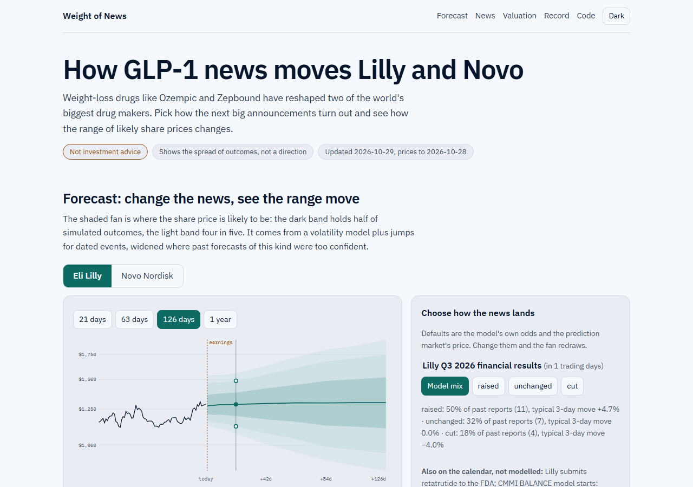

# Weight of News

**How much does GLP-1 news move the stocks of the companies that make the drugs, the ones that sell to them
and the ones that may lose from them, and can a forecast stay honest while the news keeps changing?**

**Live page: <https://deadmigue55.github.io/glp1-market-lab/>** · [Written study](docs/study.md) ·
[Findings register](docs/findings.md) · [Model card](docs/model-card.md) · [Protocol and amendments](docs/methodology.md)

*Not investment advice. The page shows the spread of possible outcomes, not a direction, and nothing here
recommends buying or selling anything.*



Pick how Lilly's next earnings report or the FDA decision on Novo's CagriSema turns out and the fan of likely
share prices redraws in your browser (a Monte Carlo in a Web Worker, checked against the Python model).
Defaults are the model's historical odds and the Kalshi market's price. Every weekday evening a GitHub
Action adds a new forecast to a public, hash-chained ledger and scores forecasts as their horizons pass.

## What it found

| | Result | Strength |
|---|---|---|
| News size | Earnings and trial days move Lilly and Novo about twice the modelled size; signed averages cancel | robust (size), power-limited (sign) |
| Surprises | Guidance revisions predict the move (2.9 pp per 1% for Lilly); weight-loss-vs-record does not | suggestive / not established |
| Losers re-rated | 11 perceived losers fell -10.5% in the month after SELECT and -19.3% after a year, no recovery | suggestive (hindsight, other news) |
| Exposure | A stock's GLP-1 factor beta does not carry over between periods (rank correlation 0.078) | robust |
| Lilly's price | Implies about $479bn of yearly peak tirzepatide sales (range 280-894), an upper bound; 22% of its return came on 7% of days | suggestive |
| Forecasting | A jump model that knows the calendar does **not** beat GARCH in CRPS (1 of 24 comparisons passes, by 0.6%); conformal calibration is what makes the intervals honest | robust / suggestive |

The negative results are part of the study: every newer method is published with its head-to-head result
against the standard it was meant to beat, including the ones that lost.

## Methods, each against the standard it must beat

| Question | Industry standard | Newer method | Verdict |
|---|---|---|---|
| How much did news move a stock? | Market-model event study, t-test | Fama-French 5 + momentum; BMP and Kolari-Pynnonen tests; wild bootstrap; HC3 + permutation | Same signed answer (null); robust size finding |
| How big is a catalyst jump? | Average CAR by event type | Hierarchical Bayesian model (PyMC), partial pooling | Feeds the forecast; wide intervals, honestly small n |
| Were the losers re-rated? | Basket vs index | Synthetic difference-in-differences (port of R `synthdid`, matches to 1e-6) | Basket-vs-SPY understates by 3-5 points |
| How do shocks spread? | Correlation matrix | TVP-VAR connectedness (port of R `ConnectednessApproach`, matches to 1e-14) | Descriptive pattern only |
| What does the price assume? | DCF, sum of the parts | Reverse DCF with an assumption band, point-in-time SEC data | Implied peak sales as an upper bound |
| Forecast distribution | Random walk, GARCH-t, filtered historical simulation | Event-driven jump-diffusion + adaptive conformal inference (Gibbs and Candes 2021) | No CRPS gain; better calibration |
| Updating with news | Analysts revise by hand | Scenario page + Kalshi prices + public hash-chained forecast ledger | Mechanism live; no scored history yet |

## How it is built

```
Yahoo prices ─┐
Ken French ───┤                 ┌─► event study (3) ─► jump sizes ─┐
SEC XBRL ─────┼─► DuckDB ───────┼─► SDID / TVP-VAR / factor (4)    ├─► forecast engine (7) ─► nightly (8) ─► live page (9)
Wikipedia ────┤   (data.md)     ├─► reverse DCF (5)                │         ▲                    │
Kalshi ───────┘                 └─► attention (6)      catalyst ───┘     conformal state    public ledger
                                                       ledger (2)
```

- `src/glp1/` the package (`glp1 doctor | ingest | build | check | ledger | study | donors | ecosystem |
  valuation | attention | forecast | nightly`); `tests/` 100+ tests including numbers-in-docs checks;
  `data/ledger/` the CC BY catalyst ledger; `results/` the JSON every number comes from; `forecasts/` the
  public ledger; `site/` the React + Vite page; `docs/` the protocol, per-step write-ups and the study.
- Protocol first: the evaluation was written before the test data was touched; changes are numbered
  amendments. An independent reviewer read each major step and their findings changed code and wording.
- Free public data only, so anyone can rerun it. Raw data is not redistributed; the ledger is.

## Reproduce

```
uv sync
uv run glp1 doctor              # every data source reachable
uv run glp1 ingest && uv run glp1 build && uv run glp1 check
uv run glp1 study               # event study + jump model (~1 min)
uv run glp1 ecosystem           # SDID, factor, connectedness (~30 min; needs R for the cross-checks)
uv run glp1 valuation && uv run glp1 attention && uv run glp1 forecast
uv run pytest
cd site && npm ci && npm run verify && npm run dev
```

## Limits worth knowing before you rely on anything here

Two stocks and one extraordinary regime; a hand-curated ledger of 116 events built with hindsight; few
independent windows at long horizons; no foundation-model baseline, no option-implied benchmark and no
patient-funnel valuation (amendments 9-12). The full list is in the [study](docs/study.md) and the
[model card](docs/model-card.md).

## Licence

Code: MIT. The catalyst ledger (`data/ledger`): CC BY 4.0. Market data belongs to its providers and is
not redistributed.
